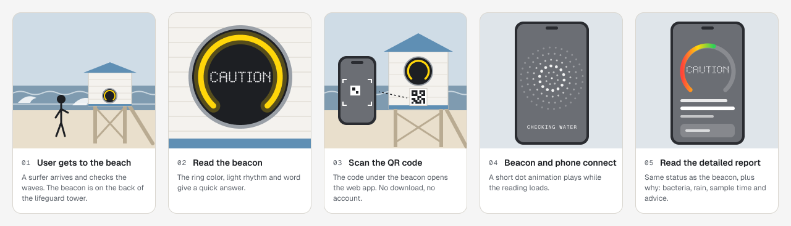
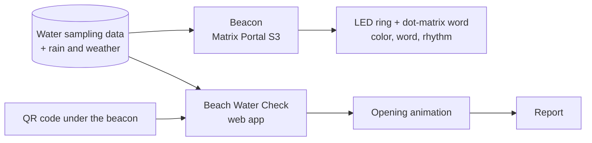

# Ocean Water Quality Beacon · Companion App

A companion web app for the Ocean Water Quality Beacon, the physical device I'm building in Physical Computing. The beacon gives the quick answer on the beach. The app explains it in more detail.

## Proposal

**Idea:** The beacon is a circular sign mounted on the back of a lifeguard tower, with a light ring and a dot-matrix text display: green GOOD, yellow CAUTION, red POOR, or grey NO DATA. A QR code under the beacon opens the companion app or mobile website, which shows the same reading and explains why the beacon says it: the bacteria result, recent rain, when the water was last sampled, and what to do.

**Who it's for:** Swimmers and surfers already at the beach, deciding in a few seconds whether to go in. Also anyone who sees the beacon and wants to know what the color means.

**Core experience:**

The storyboard is exported from the Figma file, section **Storyboard · User journey**.

1. A surfer gets to the beach and checks the waves. The beacon is mounted on the back of the lifeguard tower.
2. Read the ring color, light rhythm and word.
3. Scan the QR code under the beacon with the phone camera. No app download or account.
4. A short animation plays while the reading loads.
5. Read the detailed report: the same status as the beacon, plus the reason, the numbers behind it and advice.

## Scope and plan

| Priority | What |
|---|---|
| **Must** | Show the same reading as the beacon, from the same data and with the same timestamp. |
| | Connect in one step: scan the QR code, and a web page opens. |
| | Go deeper than the color: the bacteria result against the safe limit, rainfall, sample date and source, and plain advice. |
| **Should** | A clear No data state: if a sample is missing or too old, show NO DATA and never a status color. |
| | "Last sampled" time shown up front, so people can judge how fresh the reading is. |
| | A short explanation of the science: what Enterococci is, why rain raises it, and where the safe limit comes from. |
| | Nearby beaches: the current status of other beacons, so someone can choose a better spot. |
| | An opening animation that links the phone to the beacon (this week's experiment). |
| **Nice** | Connect to a predictive water quality forecast API. |
| | Build my own API from tides, historical results, water testing, weather and rainfall. |
| | Alerts when a saved beach changes status. |

**Stopping point:** For one beach, scanning the beacon's QR code opens a working web page. It shows the beacon's current reading, with all four states and the reasons behind each.

**One possible cut:** Nearby beaches. The app would only show the beach the person scanned, which is enough to support the beacon.

**Map:**

| | |
|---|---|
| **Components** | Beacon (LED ring, 64×64 LED matrix, Matrix Portal S3), QR code, web app (horseshoe gauge, status word, reason and advice, readings, source and test details) |
| **State and data** | Status (good, caution, poor or no data), Enterococci in MPN/100 mL, 24 h rainfall, sample ID and time, forecast note, and loading state (loading, still checking after 6 s, ready, failed → no data) |
| **Tools** | Figma (design system and mockups), HTML, CSS and canvas (prototype), Claude Code, Matrix Portal S3 firmware |
| **Resources** | Public beach water sampling results (exact source still to confirm), rain and weather data, and later a forecast model |

## Small experiment: the opening animation

**Question:** Can the wait after scanning feel like the beacon and the phone talking to each other?

**Prediction:** A field of white dots that ripples out and becomes the horseshoe would read as the phone "finding" the beacon. Keeping every dot white until the data lands would stop anyone from mistaking the loading state for a reading.

**Setup:** I built an HTML and canvas prototype of the first screen, with controls for the reading (Good, Caution, Poor, No data), how long the data takes (instant, 1.5, 4 or 10 s) and playback speed. I compared versions side by side, measured how much the dots changed each frame at 60 fps to find hitches, and copied keyframes into Figma.

**Result:**

- The first version, one dot that pinged and then split into 28 dots that flew out to draw the horseshoe, felt busy. Dots flying out of the center read as decoration, not as a connection.
- Of five dot-field openings, I chose a ripple that grows into a ring. Its outer ring becomes the horseshoe, so the loading animation turns into the gauge with no handoff.
- A white trail laps the ring with "CHECKING WATER" until the data arrives. Only then does color fill in. With a 1.5 s load, the Caution reading lands at about 3.2 s.
- Smoothing passes cut the largest single-frame jump to a third of what it was.
- The status word is now drawn as round dots, like the beacon's LED panel, so the phone and the sign look related.

**Next decision:** Test with 3–5 people before explaining anything. Do they read the animation as the phone connecting to the beacon, and does it feel too slow? Then decide whether the beacon's own ring should play the same white chase while it fetches data.

**Still uncertain:**

- Whether people read the ripple as communication or just as decoration.
- Real load times on a beach phone connection.
- How the animation reads in direct sun.

## Handoff

**Source and version:**

- Prototype: [opening-animation.html](opening-animation.html), version of Nov 23, 2026.
- First version for comparison: [first-animation.html](first-animation.html).
- Design: [Figma file](https://www.figma.com/design/J1Pb5bsoBUaovTzt8HiuRx/Ocean-Water-Quality-Beacon), page Design System.
- Process notes: [figma-mockup-process.md](figma-mockup-process.md).

**Run or inspect:**

- Download `opening-animation.html` (open the file on GitHub, then use the download button) and double-click it to open it in Chrome or Safari. Nothing to install; it needs internet only for fonts.
- Use **Current reading**, **Data arrives after** and **Playback** to replay each state. Drag the timeline to step through frames.
- `first-animation.html` opens the same way, for comparison.

**AI and source credits:**

- Claude (Claude Code) helped write the prototype code, build and edit Figma frames, run comparisons and edit copy, including this README. Design and direction choices were mine.
- Visual references: Ramin Nasibov (Aurevia, PRORS), Melody Ekbatani (Aeri), OEM (oem.care), plus two motion references (sonar rings to a dot ring, and a gauge filling as its number counts up).
- Fonts: Geist, Geist Mono and Doto from Google Fonts.

**Privacy check:**

- No accounts, no location and no personal data. The QR code opens a fixed page for that beacon's beach.
- The prototype loads fonts from Google Fonts, which sends the visitor's IP address to Google. Hosting the fonts with the app would remove that.
- No analytics yet. If added later, keep them anonymous and say so on the About page.

**Accessibility check:**

- Done:
  - Status is never shown by color alone (word, gauge position and the beacon's light rhythm).
  - Main text meets 4.5:1 contrast.
  - Touch targets are 44 pt.
  - The dot-matrix word has a text label for screen readers.
  - The animation is replaced by a simple crossfade when the phone's reduced-motion setting is on.
- Still to check:
  - A full VoiceOver pass.
  - Legibility in direct sun.
  - A color-blindness simulation.
  - Whether the status word should grow with the phone's text size, since it's drawn rather than typed.
